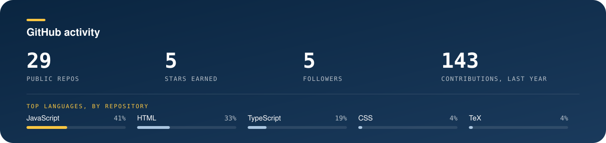

<picture>
  <source media="(prefers-color-scheme: dark)" srcset="assets/banner-dark.svg?v=3">
  <source media="(prefers-color-scheme: light)" srcset="assets/banner-light.svg?v=3">
  
</picture>

  
  
  

  

<b>About me</b>

 

I build production backends and AI systems. Five years in, most of my work sits where **retrieval, LLMs and cloud infrastructure** meet: search that answers only from what it retrieved, pipelines that turn raw audio and text into structured reports, and APIs that keep one tenant's data away from another's.

I also like the front of the stack. UI design and clean admin dashboards started as a hobby and became part of the job.

### AI, with receipts

  <picture>
    <source media="(prefers-color-scheme: dark)" srcset="assets/prompt-demo-dark.svg?v=3">
    <source media="(prefers-color-scheme: light)" srcset="assets/prompt-demo-light.svg?v=3">
    
  </picture>

A grounded answer cites what it retrieved. If the sources do not cover the question, it says so.

<b>What I work on</b>

 

| Area | What it looks like |
| --- | --- |
| **RAG and vector search** | Hybrid vector and keyword retrieval, grounded Q&A, embedding cost control |
| **LLM pipelines** | Transcript to structured report, chunking, token budgets, JSON-schema output |
| **Cloud and streaming** | Low-latency live and on-demand video on managed cloud services, infrastructure as code |
| **Secure APIs** | REST design, scope-based RBAC, tenant isolation, signed URLs |
| **Modernisation** | Moving legacy modules to typed, tested REST services |

<b>How I like to build</b>

 

- **Ground it.** An answer should trace back to a source the system actually retrieved.
- **Measure it.** Retrieval quality gets a metric before it gets a claim.
- **Scope it.** Every endpoint checks who is asking and what they may see.
- **Keep it cheap.** Idle infrastructure and oversized embeddings are bugs.

<b>Certification</b>

 

Microsoft Certified: **Azure AI Engineer Associate (AI-102)**, covering Azure AI services, speech-to-text, LLM integration and AI solution deployment.

<b>Beyond code</b>

 

UI and graphic design, reading and writing, travelling to new places. I speak English and Hindi.

  

  <picture>
    <source media="(prefers-color-scheme: dark)" srcset="assets/skills-dark.svg?v=3">
    <source media="(prefers-color-scheme: light)" srcset="assets/skills-light.svg?v=3">
    
  </picture>

### GitHub activity

  <picture>
    <source media="(prefers-color-scheme: dark)" srcset="https://raw.githubusercontent.com/jai-ghai/jai-ghai/output/stats-dark.svg">
    <source media="(prefers-color-scheme: light)" srcset="https://raw.githubusercontent.com/jai-ghai/jai-ghai/output/stats-light.svg">
    
  </picture>

  <picture>
    <source media="(prefers-color-scheme: dark)" srcset="https://raw.githubusercontent.com/jai-ghai/jai-ghai/output/github-snake-dark.svg">
    <source media="(prefers-color-scheme: light)" srcset="https://raw.githubusercontent.com/jai-ghai/jai-ghai/output/github-snake.svg">
    
  </picture>

### Get in touch

The fastest way is [LinkedIn](https://in.linkedin.com/in/jai-ghai-3b4592162). I also post on [X](https://x.com/jaighai8).
