<picture>
  <source media="(prefers-color-scheme: dark)" srcset="assets/banner-dark.svg">
  <source media="(prefers-color-scheme: light)" srcset="assets/banner-light.svg">
  
</picture>

  
  
  

## About

I build production backends and AI systems. Five years in, most of my work sits where **retrieval, LLMs and cloud infrastructure** meet: search that answers only from what it retrieved, pipelines that turn raw audio and text into structured reports, and APIs that keep one tenant's data away from another's.

I also like the front of the stack. UI design and clean admin dashboards are a hobby that became part of the job.

## What I work on

| Area | What it looks like |
| --- | --- |
| **RAG and vector search** | Hybrid vector and keyword retrieval, grounded Q&A, embedding cost control |
| **LLM pipelines** | Transcript to structured report, chunking, token budgets, JSON-schema output |
| **Cloud and streaming** | Low-latency live and on-demand video on managed cloud services, infrastructure as code |
| **Secure APIs** | REST design, scope-based RBAC, tenant isolation, signed URLs |
| **Modernisation** | Moving legacy modules to typed, tested REST services |

## Stack

## Certification

Microsoft Certified: **Azure AI Engineer Associate (AI-102)**, covering Azure AI services, speech-to-text, LLM integration and AI solution deployment.

## Beyond code

UI and graphic design, reading and writing, travelling to new places. English and Hindi.

## Get in touch

The fastest way is [LinkedIn](https://in.linkedin.com/in/jai-ghai-3b4592162). I also post on [X](https://x.com/jaighai8).

This page is a README in a repository named <code>jai-ghai</code>. GitHub shows it on the profile.
